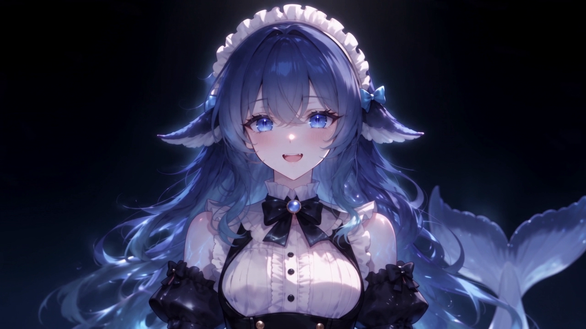
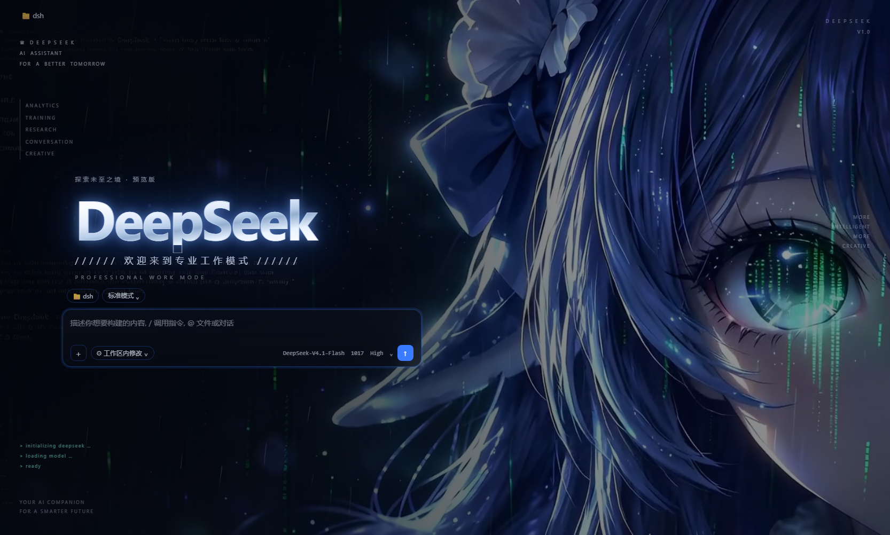

# dsh-whale-boot-theme

一套开箱即用的「鲸鱼娘」主题，装完重启一次就位：

1. **开机动画** —— 霓虹线条里走出来的鲸鱼娘，闭眼 → 睁眼。本地片段，MIT，随包内置。
2. **动态背景** —— 蓝发少女的脸部与眼睛特写，眼里淌着代码，青色数据雨一直在下。
3. **整套主题** —— 冷黑蓝底、1px 全息结构线、电光蓝品牌色、青色状态色；面全是薄玻璃，背后永远在流动。
4. **首屏左岸版式** —— 空对话时首页不再是居中的三件套：输入卡靠左一栏、DeepSeek 金属大字标、中文副题、左边沿 HUD 细目与四角角标，右半屏整块留给动态背景。这段是我们自己写的附录 CSS，追加在作者 `patches.css` 末尾，整段删掉即可复原。

> 背景与主题的作者是 **stushansusu**（CC BY-NC-SA 4.0），本插件不打包它们，而是在首次
> 启动时从原作者仓库下载、校验 sha256、再应用到本机。详见 [NOTICE](./NOTICE)。




## 安装

```bash
# 从 GitHub 装（还没上 npm 之前用这条）
dsh plugin add github:bluestar2019/dsh-whale-boot-theme
```

网络打不开 GitHub 时，走 Gitee 镜像：

```bash
dsh plugin add git+https://gitee.com/maisutong/dsh-whale-boot-theme-0.1.0.git
```

上架 npm 之后也可以直接写包名：

```bash
dsh plugin add dsh-whale-boot-theme
```

本地开发时也可以直接装目录：

```bash
dsh plugin add file:/path/to/dsh-whale-boot-theme
```

装完**重启一次 DSH**：插件在启动后约 2.5 秒跑一次安装流程（宿主半边，没有界面），
日志里会出现 `dsh-whale-boot-theme` 的四五行进度。之后每次启动都是幂等的：文件齐了就
直接跳过，不会重复下载。

## 它到底做了什么

启动后，按下面的顺序，**每一步失败都不影响后面**，最终结果写进
`$DSH_HOME/profiles/<profile>/.dsh-whale-boot-theme.json`：

| 步骤 | 行为 |
| --- | --- |
| 下载皮肤 | 把 `skin.json` / `skin.css` / `patches.css` / `assets/whale-fantasy-loop.mp4` 下载到 `$DSH_HOME/skins/whale-fantasy/`。三个镜像依次尝试，`.part` 临时文件 + 原子 rename，大文件带停滞看门狗，视频校验 sha256。 |
| 可读性调优 | 改 `skin.css` 里 4 个背景 token、加深 `skin.json` 的 `scrim`（改动内容逐条写在 NOTICE 里）。 |
| 首屏版式 | 把随包的 `assets/hero-left.css` 追加到 `patches.css` 末尾。已装过则以 `HERO-LEFT` 标记定位、整段替换（升级自动换新，不叠加）；作者原版 CSS 一个字节都不改。 |
| 激活主题 | 写 `$DSH_HOME/skin-center-active.json`。**只在没人选过皮肤时**（空 / 还是内置默认的 `blue-fantasy`）才写，绝不覆盖你自己的选择。 |
| 装开机动画 | 如果装了 `@ljwei-stak/dsh-boot-animation`，把内置片段复制进它的自定义视频目录，并改配置让它成为开屏片段。没装就静默跳过。 |

## 配置

在 `cordis.patch.yml` 里给插件传 `config`（全部可省略）：

```yaml
- id: dsh-whale-boot-theme
  config:
    downloadAssets: true      # false = 不联网，只做本机已有文件的调优
    tuneReadability: true     # false = 保持作者原版的透明度/遮罩
    heroLayout: true          # false = 不追加首屏左岸版式（保持居中三件套）
    activateSkin: true        # false = 只装不激活
    installBootClip: true     # false = 不动开机动画
    skinId: whale-fantasy     # 皮肤目录名，必须与作者 skin.json 的 id 一致（CSS 按 id 作用域）
    ref: de02a7fc92a34ec4e565592e6a2cfa85ecae18b1   # 上游 commit，钉版本保证可重复
```

想换配色/透明度，最省事的办法是装完之后直接改
`$DSH_HOME/skins/whale-fantasy/skin.css`，并把 `tuneReadability` 关掉，免得下次启动被覆盖。

## 网络

只访问三个域名，全部是上游素材的镜像，没有别的地方：

- `cdn.jsdelivr.net`
- `fastly.jsdelivr.net`
- `raw.githubusercontent.com`

没有任何遥测、没有收集、没有上传。

## 已知限制

- **暗色专用**：这张皮肤的配色是照着夜里那块画面量出来的，亮色模式下会很难看。
- 开机动画那一步依赖第三方插件 `@ljwei-stak/dsh-boot-animation`；它改名或改配置结构，
  这一步就会退化成「跳过」。
- 上游仓库被删/改路径时，下载会失败（皮肤不会坏，只是不更新）。`ref` 钉着 commit，
  所以内容本身是稳定的。
- 皮肤中心的「背景不透明度」滑块对这张皮肤无效（它写的是 `--dsw-skin-scrim`，而这张
  皮肤自己定义了 token）——所以本插件才直接改皮肤文件。

## 开发

```bash
# 干跑：装进一个临时 DSH_HOME，检查落盘结果（会真的下载 6.3 MB）
node test-dryrun.mjs

# 用真实皮肤中心的校验器验证产物能否被加载（fail-closed，非法字段会被静默丢弃）
node test-validate.mjs

# 打包内容预览
pnpm pack --dry-run
```

本机跑 node 的小抄（Windows，DSH 桌面端自带 Electron）：

```powershell
$env:ELECTRON_RUN_AS_NODE=1
& 'C:\Users\<you>\AppData\Local\Programs\DeepSeek Harness\DeepSeek Harness.exe' .\test-dryrun.mjs
```

## 仓库

- 主仓库（市场收录用）：<https://github.com/bluestar2019/dsh-whale-boot-theme>
- 国内镜像（直连可用）：<https://gitee.com/maisutong/dsh-whale-boot-theme-0.1.0>

网络打不开 GitHub 时，可以直接从镜像装：

```bash
dsh plugin add git+https://gitee.com/maisutong/dsh-whale-boot-theme-0.1.0.git
```

## 许可

- 代码：MIT（见 [LICENSE](./LICENSE)）
- 内置开机动画：MIT，作者 Alice-Marx（见 [NOTICE](./NOTICE) 第 1 条）
- 运行时下载的皮肤与背景视频：CC BY-NC-SA 4.0，作者 stushansusu（见 [NOTICE](./NOTICE) 第 2 条）

**非商业**。想商用请先换掉第 2 条里的美术。
